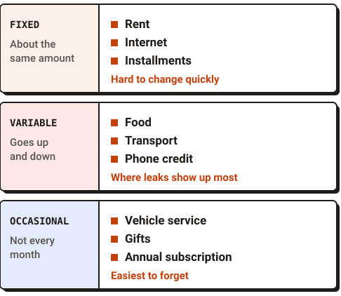
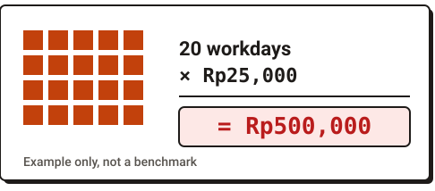
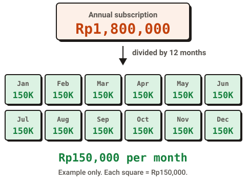
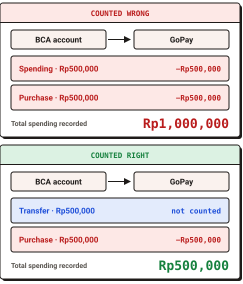
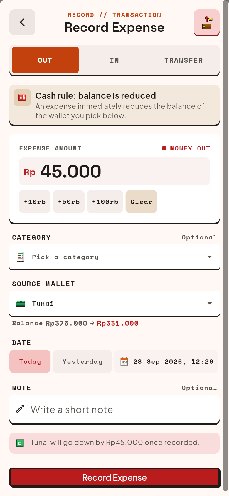

Money that runs out before the end of the month is rarely caused by one big expense. It is usually many small, repeating expenses, plus occasional costs that never make it into your calculations. The way to find out: look at the money that already left your accounts over one month, group it, and look for patterns. Guessing from memory almost always misses.

The five steps below work with any tool, from a notes app to a spreadsheet. The examples use Indonesian rupiah (Rp) and are only examples.

## 1. Start from the money that already left

Don't start by making a plan. Start by looking back. Collect every expense from the last month from three sources: your bank statements, your e-wallet history, and the cash you can remember spending.

Cash is the hardest, so rough numbers are fine. What matters is that every source is included, because missing expenses are the most common reason your month-end numbers don't add up.

## 2. Group it as fixed, variable, and occasional

Once everything is collected, split it into three groups. The split shows you which parts can actually change.

| Group | Trait | Examples |
|---|---|---|
| Fixed | About the same amount every month | Rent, internet, installments |
| Variable | Happens every month, amount goes up and down | Food, transport, phone credit |
| Occasional | Not every month, but certain to come | Vehicle service, gifts, annual subscriptions |

*Three groups of spending, with examples.*

The first group is usually hard to change in the short term. The second is where leaks show up most. The third is the easiest to forget.

## 3. Look for small expenses that repeat

An expense of Rp25,000 feels light. But if it happens on 20 workdays in a month, it adds up to Rp500,000. (This number is an example, not a benchmark.)

*Small expenses that repeat add up quickly.*

Go through the "variable" group and look for the same or similar amount showing up many times. These small repeating expenses often slip through because each time, you don't feel like you just spent something big.

The goal is not to forbid yourself anything. Just know the total, then decide for yourself whether it is worth it.

## 4. Spread annual costs across the months

An annual subscription of Rp1,800,000 feels like one big expense in a particular month. But it is the same as Rp150,000 per month. (Example calculation: Rp1,800,000 divided by 12.)

*An annual cost spread across twelve months.*

List the occasional costs you know will come in a year: renewals, vehicle tax, servicing, or gifts for family. Divide each by 12, then add them up. The result is a "hidden expense" that quietly eats your money every month, and it belongs in your calculations.

## 5. Separate money that moves from money that leaves

Moving money from a bank account to an e-wallet is not spending. The money only changes place, so your total money does not change.

A common mistake: the transfer to the e-wallet is counted as spending, and then a purchase made with that e-wallet is counted again. Your spending looks twice as large as it really is, and you can end up drawing the wrong conclusion. Mark transfers between your own wallets as a category of their own, and keep them out of your total spending.

*A transfer counted as spending doubles the total.*

## So the results don't get lost: record in one place

The five steps above can be done once, as a one-month check-up. If you want to keep seeing the pattern, the key is simple: keep your records in one place that is easy to open, and keep transfers separate from spending.

A notes app or a spreadsheet is enough for that. If your money is spread across several bank accounts and e-wallets, a tool built for recording can feel lighter. One of them is Tanukonomy, a personal money tracker for Android that is currently in [closed beta](/en/beta/).

In Tanukonomy, each bank account, e-wallet, or pile of cash is a wallet. A transfer between wallets is recorded as a transfer, so it is not counted as spending. You can also set up a budget as a spending plan, without setting the money aside. The app only records: it does not move or pay money. Your financial records are stored on your device, and core recording works without internet.

*The Record screen in Tanukonomy: choose Out, In, or Transfer. Sample data.*

## Frequently asked questions

**How long do I need to keep records before a pattern shows up?**
One month is enough to start steps 1 to 3. Occasional costs only show up fully after a few months, so you can update step 4 over time.

**Do I need a special app to do this?**
No. The five steps above work with ordinary notes. An app helps mainly when you have many wallets and want to see them all on one screen.

**Should cash be recorded too?**
It can be, because cash is often the least visible part. If that feels like too much, just note the total cash spent each week, and improve the accuracy gradually.

## In short

Money that runs out faster than planned can almost always be explained. First look at the last month's spending, group it, find the small repeating expenses, spread annual costs across the year, and keep transfers separate from spending. Once you know the cause, what to change is entirely your decision.
