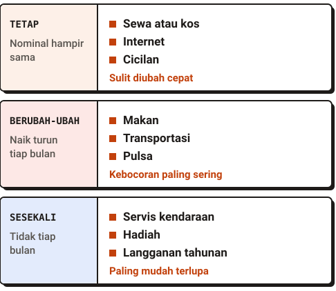
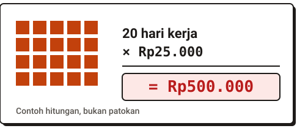
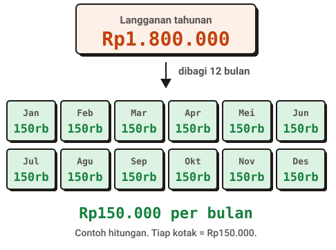
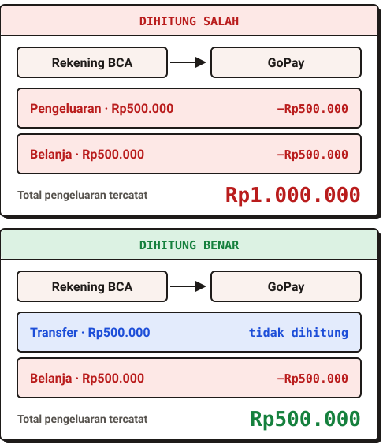
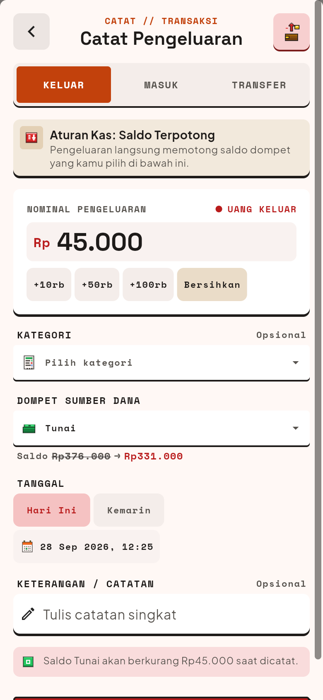

Uang yang habis sebelum akhir bulan jarang disebabkan satu pengeluaran besar. Biasanya penyebabnya banyak pengeluaran kecil yang berulang, ditambah biaya sesekali yang tidak pernah masuk hitungan. Cara menemukannya: lihat uang yang sudah keluar selama satu bulan, kelompokkan, lalu cari polanya. Menebak dari ingatan hampir selalu meleset.

Lima langkah di bawah ini bisa dikerjakan dengan alat apa saja, dari catatan ponsel sampai spreadsheet.

## 1. Mulai dari uang yang sudah keluar

Jangan mulai dengan membuat rencana. Mulai dengan melihat ke belakang. Kumpulkan semua pengeluaran satu bulan terakhir dari tiga sumber: mutasi rekening bank, riwayat e-wallet, dan uang tunai yang kamu ingat.

Uang tunai paling sulit, jadi tidak apa-apa kalau angkanya kasar. Yang penting semua sumber masuk, karena pengeluaran yang terlewat adalah penyebab paling umum angka akhir bulan tidak cocok.

## 2. Kelompokkan jadi tetap, berubah-ubah, dan sesekali

Setelah semuanya terkumpul, bagi ke tiga kelompok. Pembagian ini membantu kamu melihat bagian mana yang bisa diubah.

| Kelompok | Ciri | Contoh |
|---|---|---|
| Tetap | Nominal hampir sama tiap bulan | Sewa atau kos, internet, cicilan |
| Berubah-ubah | Ada tiap bulan, nominalnya naik turun | Makan, transportasi, pulsa |
| Sesekali | Tidak tiap bulan, tapi pasti datang | Servis kendaraan, hadiah, langganan tahunan |

*Tiga kelompok pengeluaran dan contohnya.*

Biasanya kelompok pertama sulit diubah dalam jangka pendek. Kelompok kedua tempat kebocoran paling sering muncul. Kelompok ketiga paling mudah terlupa.

## 3. Cari pengeluaran kecil yang berulang

Pengeluaran Rp25.000 terasa ringan. Tetapi kalau terjadi 20 hari kerja dalam sebulan, jumlahnya Rp500.000. (Angka ini contoh, bukan patokan.)

*Pengeluaran kecil yang berulang cepat membesar.*

Telusuri kelompok "berubah-ubah" dan cari nominal yang sama atau mirip yang muncul berkali-kali. Pengeluaran kecil yang berulang ini sering lolos karena tiap kali terjadi, kamu tidak merasa baru menghabiskan sesuatu yang besar.

Tujuannya bukan melarang diri sendiri. Cukup tahu berapa totalnya, lalu putuskan sendiri apakah itu sepadan.

## 4. Ratakan biaya tahunan menjadi biaya bulanan

Langganan tahunan Rp1.800.000 terasa seperti satu pengeluaran besar di bulan tertentu. Padahal setara Rp150.000 per bulan. (Contoh hitungan: Rp1.800.000 dibagi 12.)

*Biaya tahunan yang diratakan ke dua belas bulan.*

Daftar biaya sesekali yang kamu tahu pasti datang dalam setahun: perpanjangan, pajak kendaraan, servis, atau hadiah untuk keluarga. Bagi masing-masing dengan 12, lalu jumlahkan. Hasilnya adalah "pengeluaran tersembunyi" yang diam-diam ikut menghabiskan uangmu tiap bulan, dan layak dimasukkan ke hitungan.

## 5. Pisahkan uang yang pindah dari uang yang keluar

Memindahkan uang dari rekening ke e-wallet bukan pengeluaran. Uangnya hanya berpindah tempat, jadi total uangmu tidak berubah.

Kesalahan yang sering terjadi: transfer ke e-wallet dihitung sebagai pengeluaran, lalu belanja memakai e-wallet itu dihitung lagi. Hasilnya pengeluaranmu tampak dua kali lebih besar dari kenyataan, dan kamu bisa menyimpulkan hal yang salah. Tandai transfer antar dompetmu sendiri sebagai kategori tersendiri, dan jangan masukkan ke total pengeluaran.

*Transfer yang dihitung sebagai pengeluaran membuat totalnya dua kali lipat.*

## Supaya hasilnya tidak hilang: catat di satu tempat

Kelima langkah tadi bisa dikerjakan sekali sebagai pemeriksaan satu bulan. Bila kamu ingin melihat polanya terus, kuncinya sederhana: simpan catatan di satu tempat yang mudah dibuka, dan pisahkan transfer dari pengeluaran.

Catatan ponsel atau spreadsheet sudah cukup untuk itu. Kalau uangmu tersebar di beberapa rekening dan e-wallet, alat yang memang dibuat untuk mencatat bisa terasa lebih ringan. Salah satunya Tanukonomy, aplikasi catatan keuangan pribadi untuk Android yang sedang dalam [uji coba tertutup](/beta/).

Di Tanukonomy, tiap rekening, e-wallet, atau uang tunai menjadi satu dompet. Transfer antar dompet dicatat sebagai transfer, jadi tidak terhitung sebagai pengeluaran. Kamu juga bisa menyusun anggaran sebagai rencana belanja, tanpa memisahkan uangnya. Aplikasi ini hanya mencatat: ia tidak memindahkan atau membayarkan uang. Catatan keuanganmu tersimpan di perangkat, dan pencatatan inti bisa dipakai tanpa internet.

*Layar Catat di Tanukonomy: pilih Keluar, Masuk, atau Transfer. Data contoh.*

## Pertanyaan yang sering muncul

**Berapa lama saya perlu mencatat sebelum polanya terlihat?**
Satu bulan sudah cukup untuk memulai langkah 1 sampai 3. Biaya sesekali baru terlihat penuh setelah beberapa bulan, jadi langkah 4 bisa kamu perbarui seiring waktu.

**Perlu aplikasi khusus untuk melakukan ini?**
Tidak. Lima langkah di atas bisa dikerjakan dengan catatan biasa. Aplikasi membantu terutama bila dompetmu banyak dan kamu ingin semuanya terlihat di satu layar.

**Apakah uang tunai harus dicatat juga?**
Bisa dicatat, karena uang tunai sering menjadi bagian yang paling tidak terlihat. Kalau terasa berat, catat saja total uang tunai yang keluar per minggu, lalu perbaiki ketelitiannya pelan-pelan.

## Ringkasnya

Uang yang habis lebih cepat dari rencana hampir selalu bisa dijelaskan. Lihat dulu pengeluaran sebulan terakhir, kelompokkan, cari pengeluaran kecil yang berulang, ratakan biaya tahunan, dan pisahkan transfer dari pengeluaran. Setelah kamu tahu penyebabnya, keputusan tentang apa yang diubah sepenuhnya milikmu.
